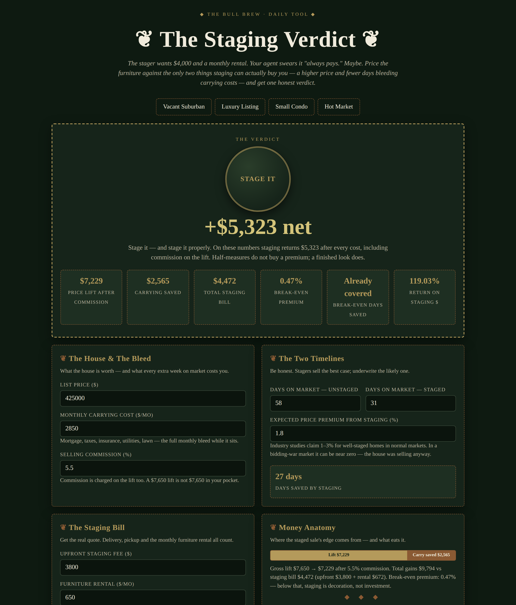

# The Staging Verdict

**Live:** https://thebullbrew.github.io/staging-verdict/
**Repo:** https://github.com/thebullbrew/staging-verdict

## What it does

The stager wants thousands up front plus a monthly furniture rental, and your agent swears staging "always pays." This tool prices that promise honestly — against the only two things staging can actually buy you: a higher sale price and fewer days bleeding carrying costs.

You get a wax-seal verdict — **STAGE IT**, **STAGE LIGHT**, **CLOSE CALL**, or **SKIP IT** — along with the price lift after commission, carrying saved, the total staging bill, the break-even premium staging must deliver, the break-even days it must save, return on the staging dollar, a money-anatomy bar, premium sensitivity (0–5%) and speed sensitivity tables, four presets (Vacant Suburban, Luxury Listing, Small Condo, Hot Market), saveable cases in your browser, and a copy-ready summary.

## The method

- **Price lift, honestly** = list price × expected premium %, minus the selling commission charged on that lift — a $7,650 lift is not $7,650 in your pocket.
- **Carrying saved** = (unstaged days − staged days) ÷ 30 × your true monthly carrying cost (mortgage, taxes, insurance, utilities).
- **Total staging bill** = upfront fee + monthly furniture rental × staged months. A slow sale rents the sofa again every month.
- **Net** = lift after commission + carrying saved − total staging bill. **Break-even premium** solves the premium at which net is exactly zero; **break-even days** solves the speed staging must deliver at your assumed premium.
- No backend, no accounts, no tracking — everything runs in the page and saved cases live only in your browser's local storage.

Education, not advice. Ask your agent for staged-vs-unstaged comps on your own street before you spend a dollar.

## How to run

Open `docs/index.html` in any browser, or serve the `docs/` folder with any static host. It installs as a PWA and works offline after the first visit.

---
Part of The Bull Brew daily finance & real-estate tool series — one useful tool, every day. Design: Variation 7, Hunter's Lodge.
